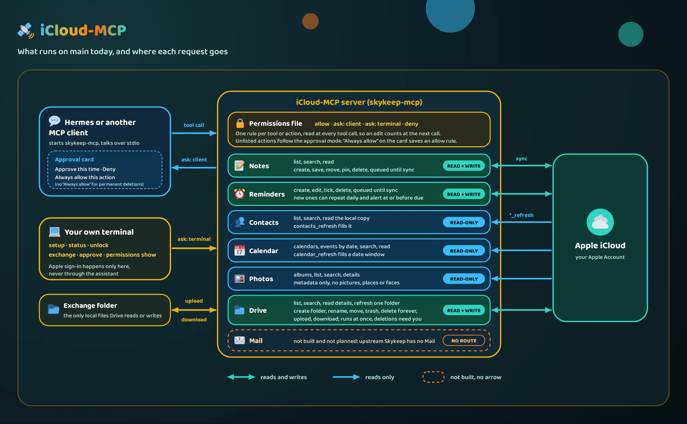

# iCloud-MCP

iCloud-MCP is a local MCP server for Apple Notes, Reminders, Contacts, Calendar, Photos and iCloud Drive. It is a fork of Skykeep and runs on the Skykeep engine. The command is `skykeep-mcp`. It speaks newline-delimited JSON-RPC over stdio, keeps its own private library directory and has no network listener.

- Notes and Reminders can be read and changed. Changes wait in a local queue until `sync` sends them. A new reminder can repeat daily and alert at its due time or before it.
- Contacts and Calendar are read-only. Photos reads give metadata only, never the pictures. `photos_write` changes photo details and albums, uploads a file from the exchange folder, and moves a photo to Recently Deleted only with your approval.
- iCloud Drive can be read and changed with `drive_write`. File contents move only through one local exchange folder you set up, and deletions always need your approval.
- `setup` guides you through sign-in in your own terminal. `status` checks the setup and `unlock` opens the protected sign-in file after a restart.
- A permissions file sets each tool or action to `allow`, `ask` or `deny`. With `ask: client` your MCP client shows a card with "Approve this time", "Deny" and "Always allow this action". The server reads the file at every tool call, so an edit counts from the next call.
- Mail is not implemented and not planned, because upstream Skykeep has no Mail support.

## Architecture



Edit `docs/architecture.html` and re-export `docs/architecture.webp` whenever a route changes.

## Build

```sh
cargo build --release -p skykeep-mcp
```

The workspace's default member is this crate, so `cargo build` and `cargo test` without `-p` also build only the headless server. The desktop and mobile apps stay in the workspace and build with their own `-p` flags. Linux needs `pkg-config` and the D-Bus development headers for the Secret Service client: on Debian or Ubuntu `sudo apt install pkg-config libdbus-1-dev`, on Fedora `sudo dnf install pkgconf-pkg-config dbus-devel`, on Arch `sudo pacman -S pkgconf dbus`. Rust itself comes from [rustup.rs](https://rustup.rs).

## Get started

After the build, the program is at `target/release/skykeep-mcp`. Install it where your terminal finds programs:

```sh
mkdir -p ~/.local/bin
install -m 755 target/release/skykeep-mcp ~/.local/bin/
```

If your terminal then says it can't find `skykeep-mcp`, type `~/.local/bin/skykeep-mcp` wherever this guide says `skykeep-mcp`. `skykeep-mcp --help` lists every command.

You need a terminal window that you open yourself. Don't run these commands through an AI assistant or chat: what you type there can end up in a transcript.

1. Run the guided setup:

   ```sh
   skykeep-mcp setup
   ```

   It walks you through five steps and tells you what each one does:

   1. **Folder.** Where iCloud-MCP keeps its private data. Press Enter to use the suggested folder, `~/.local/share/skykeep-mcp`, or type another one as a full path starting with `/` or `~`. Setup asks before it creates a folder. With another folder, add `--state-dir FOLDER` to every command; setup and status print each command with it already filled in.
   2. **Where your sign-in is kept.** Your computer's password store when it has one, otherwise a protected file (see below).
   3. **Apple sign-in.** Your Apple Account, your password and then a verification code. Your account, password and code are not shown as you type. You pick a number for where Apple sends the code: your Apple devices, or a text message to one of your phone numbers if Apple lists any. At the code you can type `b` to go back and pick the other way without typing your password again.
   4. **Approval mode.** When the assistant has to ask you before it acts:

      | Choice | Reads and refreshes | Changes, including deletion |
      | --- | --- | --- |
      | 1. Ask before every read and every change (recommended, `reads_and_writes`) | Asks you in the MCP client | Asks you in the MCP client |
      | 2. Read without asking, ask before every change (`writes_only`) | No question | Asks you in the MCP client |
      | 3. Don't ask, not even before deleting notes or reminders (`yolo`, you type `confirm`) | No question | No question, except Drive deletions, and moves and renames of large Drive folders, which wait for `skykeep-mcp approve` in a terminal (see "Drive changes") |
      | 4. No approval mode, for clients without approval forms (you type `confirm`) | No question | Routine changes: no question. Deletions, and renames and moves of Drive folders with 20 or more items or an unknown count, wait until you run `skykeep-mcp approve` in a terminal |

      Choices 1 and 2 need an MCP client that can show iCloud-MCP's approval card. Hermes supports MCP form elicitation and shows the card. In a client or session without approval forms, every request that needs approval fails with `approval_requires_form_client`; use choice 4 or set those actions to `ask: terminal` in the permissions file (see "Permissions file" below). Choice 4 keeps a folder's earlier `require-approval` setting: then every change waits for `skykeep-mcp approve`, and setup and status say so. Once a folder has had choice 1, 2 or 3, it can't go back to 4; set up a new folder instead.
   After step 4, setup offers to write a starter permissions file. In it every deletion asks the way your approval mode already asks, or more strictly. Press Enter to skip it.
   5. **Check.** Setup checks everything it set up and prints what to paste into your MCP client's settings: a JSON line for most clients, and a `config.yaml` block for Hermes.

   You can run `setup` again at any time. It checks the saved sign-in with Apple, then asks whether to keep the setup, sign in again in the same folder (same Apple Account), switch to another Apple Account, or quit. If Apple no longer accepts the saved sign-in, setup says so and goes straight to signing in again. A folder belongs to one Apple Account, so switching sets up a new folder for the other account and leaves the first one as it is. If setup stopped part way, the next run continues with the first step that is not done.

2. Check that everything is ready:

   ```sh
   skykeep-mcp status
   ```

   It only looks at this computer: it never contacts Apple and never asks for a password. Each problem comes with the next step to take. It ends with an error code when something needs fixing, so scripts can check it.

3. Only if setup chose the protected file: after each restart of the computer, run this once before you use the assistant:

   ```sh
   skykeep-mcp unlock
   ```

### Where your sign-in is kept

iCloud-MCP never writes your sign-in to a plain file. There are two options:

- **Your computer's password store** (the system keyring, such as GNOME Keyring or KWallet). Setup uses it when it is running and unlocked. Nothing more to do after a restart once you have logged in to your desktop.
- **A protected file** in the iCloud-MCP folder, for computers without a usable password store, such as a server you reach over SSH. You choose a passphrase of at least 12 characters, typed twice. The file is encrypted with it (AES-256-GCM, key derived with PBKDF2-HMAC-SHA256). After each restart, `skykeep-mcp unlock` asks for the passphrase once and gives the server the key through the Linux kernel's own key storage, so the server can read the file without a desktop. The key is never written to a file. Like the system keyring, it can be read by programs running as your user, and by nobody else. Until you unlock, the server's tools answer `locked: run skykeep-mcp unlock in a terminal`. To make the key expire earlier than the next restart, use `skykeep-mcp unlock --hours 8`; a later plain `skykeep-mcp unlock` removes that limit again.

If neither is available, setup stops and says so instead of keeping the sign-in anywhere less safe. If you are inside Docker or a similar container, run iCloud-MCP directly on the computer; on a desktop, log in to the desktop session first. When the option you chose stops working (the keyring is gone, or the kernel key storage is blocked), setup offers the other one. Switching asks you to type `switch`, removes the sign-in kept the old way, and you sign in to Apple again. If the old keyring can't be reached at all, setup says that an older entry may stay there unused; before the folder ever uses that keyring again, setup erases it. A locked keyring is never switched away from: unlock it instead. If you forget the passphrase, run `setup` again and choose to start over with a new one; you then sign in to Apple again, and your cached data stays.

Your Apple password is never stored. When Apple asks you to sign in again, run `setup` again and choose to sign in again in this folder.

### Sign in and out by hand

`setup` uses the same sign-in as these commands, which still work on their own:

```sh
skykeep-mcp login --state-dir ~/.local/share/skykeep-mcp
skykeep-mcp logout --state-dir ~/.local/share/skykeep-mcp
```

`login` asks for your Apple Account, password and verification code with echo turned off. It reads only from the terminal you opened, never from a pipe, an argument or an environment variable. It refuses to start when it sees markers that an agent runtime launched it (`HERMES_AGENT`, `AI_AGENT`, `HERMES_SESSION_ID`, `CODEX_SANDBOX`, `CLAUDECODE`), because an agent-owned terminal can copy what you type into a transcript. That check only catches runtimes that set those markers; an agent with shell access can unset them (see "Write approval" below).

For the code you pick a number from a short list: one sends the code to your Apple devices, and each phone number Apple lists (shown as Apple masks it) gets a text message or a call. At the code prompt, type `b` to go back and pick another way; one sign-in asks Apple for at most four codes. A wrong or expired code can be retried twice. Ctrl-C, Ctrl-D, Escape or three minutes without input cancel the sign-in and nothing is saved.

What is kept afterwards:

- The session and trust tokens, in the storage chosen above. With the system keyring they are under the service name `skykeep-mcp`, one entry per folder. The server never imports a session from the Skykeep desktop app.
- A one-way account tag in the library, so a folder can't be reused for another Apple Account. Use a new folder for a different account.

The folder must be owned by you, mode `0700`, and contain no symlinks or files readable by others. The one exception is `permissions.yaml`: a shared or linked copy doesn't stop the folder, and iCloud-MCP treats that file as unusable (see "Permissions file"). The server and the helper commands take an exclusive lock on it for each operation. If a command meets a request in progress it stops with `state_busy_retry`; run it again. A running server picks up the new session on its next request, without a restart.

`logout` erases the stored session and the cookie file, which is sealed with a key kept beside the session. Cached data stays in the folder until you delete it. If the system keyring is locked, the sign-out is recorded and finished the next time the keyring answers; until then no session is loaded. With the protected file, run `unlock` first.

## Run the server

```sh
skykeep-mcp --state-dir ~/.local/share/skykeep-mcp
```

Configure your MCP client to start that command. Stdout carries protocol messages only. JSON-RPC batches are not supported and get an `Invalid Request` error. Several clients can share one directory: operations take turns on the lock, and a server that starts while another holds it still answers `initialize`, then returns `state_busy_retry` from each tool call until the lock is free. Setup prints the exact line to paste. The server never opens a keyring unlock dialog or a sign-in prompt; if the keyring is locked or the session has expired, tools return `login_required` with instructions, and with a protected file that is not unlocked they return `locked: run skykeep-mcp unlock in a terminal`. `auth_status` names the folder in that command, and says which other problem a protected file has, such as a damaged file or a blocked kernel key storage. While running it refreshes Notes and Reminders every five minutes; a failed pass waits for the next interval rather than retrying.

## Tools

| Tool | What it does |
|---|---|
| `auth_status` | Whether the folder is bound to an account, whether the protected file is locked, and how to sign in. Takes no arguments and never accepts secrets. |
| `sync` | Refreshes Notes and Reminders, then sends queued changes. Nothing is sent when the refresh fails. `left_queue_this_sync` lists each write that left the queue, with outcome `cloudkit_accepted` or `finished_unconfirmed` (see Reminders below). |
| `sync_status` | Last refresh per service, whether the last pass failed, and counts of pending and refused changes. No network access. |
| `notes_list`, `notes_folders`, `notes_search`, `notes_get` | Read the local cache. `notes_get` returns the plain text and the native formatting runs. |
| `notes_write` | Queues `create`, `save`, `move`, `pin` or `delete`. Edits to an existing note need the `base_etag` you read, and are refused for locked or read-only notes. |
| `reminders_lists`, `reminders_list`, `reminders_search`, `reminders_get` | Read the local cache. |
| `reminders_write` | Queues `create`, `edit`, `tick` (complete or reopen) or `delete`. An `edit` changes only the fields in `patch`; moving a reminder is an edit of `list_guid`. A `create` can also take `repeat`, `due_time_alert`, `early_alert` and `timezone` (see Reminders below). |
| `contacts_list`, `contacts_search`, `contacts_get` | Read the local Contacts cache. Read-only. |
| `contacts_refresh` | Reads Contacts from Apple into the local cache, replacing it. Never writes to Apple and never opens a sign-in prompt. |
| `calendar_calendars`, `calendar_events`, `calendar_search`, `calendar_get` | Read the local Calendar cache. Read-only. |
| `calendar_refresh` | Reads Calendar from Apple into the local cache over a bounded window, replacing it. Never writes to Apple, never answers invitations and never opens a sign-in prompt. |
| `photos_albums`, `photos_list`, `photos_search`, `photos_get` | Read the cached metadata of your personal Photos library: dates, kind, size, filename, title, caption, keywords. No pictures, places or faces. Read-only. |
| `photos_refresh` | Reads Photos metadata from Apple into the local cache, a bounded batch per call, so a large library takes several calls. Never downloads pictures and never changes photos or albums. |
| `photos_write` | Changes the personal Photos library with one `action`: `upload`, `set_favorite`, `set_title_and_caption`, `set_rating`, `set_keywords`, `set_date`, `create_album`, `rename_album` or `trash`. Runs against Apple once it is allowed; see "Photos changes" below. |
| `drive_list`, `drive_get`, `drive_search` | List a cached iCloud Drive folder, read one item's details, or search names. Paths look like `/Documents/Taxes`. Metadata only: no file contents and no local paths. Read-only. |
| `drive_refresh` | Reads one Drive folder's item list (and those on its path) from Apple into the local cache. Never changes anything in Drive. |
| `drive_write` | Changes Drive with one `action`: `create_folder`, `rename`, `move`, `trash`, `delete_forever`, `upload` or `download`. Runs against Apple once it is allowed; see "Drive changes" below. |

Contacts, Calendar, Photos and Drive start empty: call their `*_refresh` tool once to fill the cache, and again whenever you want newer data. Their refresh is not part of `sync`.

Reads come from the local cache and say so (`"source": "local_cache"`). A successful Notes or Reminders write means the change is queued in the library's durable outbox; `remote_verified` is always `false`, because the server does not read each field back from iCloud after sending. Drive changes are not queued: see the next section.

## Drive changes

`drive_write` finds its target in the local cache by cloud path or id, as `drive_get` does, so run `drive_refresh` on the folder first. Drive has no outbox here: an allowed change runs at once and the reply says what happened.

- `"outcome": "done"` comes with `checked`, which says exactly what was confirmed. A rename, move, trash or delete forever is read back from Apple (`remote_verified: true`). An upload is checked against Apple's checksum of the bytes and read back at its size. A new folder is only what Apple's answer described, and a download only counts the bytes; both say `remote_verified: false`. A download asks Apple for the cached version and is refused when Apple has a newer one; `version_checked: false` says when that could not be checked (an empty file, or one cached without a version).
- An error means it did not happen, or could not be confirmed, with two exceptions: `already_has_this_name` and `already_in_destination` mean the change is already done. `drive_write_outcome_unknown_run_drive_refresh_before_retrying` means the connection ended before Apple answered: refresh the folder and look before trying again. If `delete_forever` moved the item to Recently Deleted but Apple did not delete it from there, the error is `drive_trashed_not_deleted_forever_it_is_in_recently_deleted`: delete it from Recently Deleted in iCloud Drive, or leave it for Apple to delete after about 30 days. Errors that leave you something to do carry an `instructions` line.
- Before a change, the folder is read from Apple. A new folder or upload whose name is already there is refused (`name_taken`, compared without case). A rename Apple already shows says `already_has_this_name`, and a move already made says `already_in_destination`. Apple's listing can lag a moment behind a file it has just filed: an upload retried in that moment is filed under a free name such as `plan 2.txt`, never over the first, and its reply says `renamed_by_apple: true`. Look at the folder and remove the extra copy if you don't want it. An item that changed at Apple since it was cached is left alone (`drive_item_changed_run_drive_refresh`).
- Afterwards the folders the change touched read as not yet refreshed, until `drive_refresh` reads them again.

Approvals. `trash` moves an item to Recently Deleted, where Apple keeps it about 30 days. `delete_forever` moves it there and then deletes it for good. Both always need your approval, and so does renaming or moving a folder with 20 or more items, or with an unknown number (a folder not yet read that holds anything, or one with a folder beneath not yet read). The approval shows a preview of what the change reaches: the item, its path, Apple's count of its items, how many are cached beneath it, and the first names. You approve or deny them in one of two places. Under `reads_and_writes` and `writes_only`, every Drive change is asked in the MCP client's approval form. Under `yolo`, or in a folder with no approval mode, these changes return `approval_required` with a request ID, and you approve them with `skykeep-mcp approve --state-dir DIR` in your own terminal. No mode runs a deletion without one of the two. That command runs the change and prints the outcome. A request is used once, and it is refused if the account, the approval mode, the folder, the cached item or the permissions file changed since it was made, or if the file now says `deny`. In a folder with no approval mode, `require-approval` makes every Drive change wait for `approve`.

The permissions file can name `drive_write` and each of its actions (see "Permissions file"). `deny` refuses, and `allow` runs other Drive changes without asking. A deletion, or a rename or move of a large folder, still needs a person whatever the file says: with `allow` it is asked as above, in the form or in the terminal. `ask: terminal` sends any Drive change to `skykeep-mcp approve`, and `ask: client` asks on the card, also under `yolo`. A card approval then counts and is not asked again in the terminal. The card never offers "Always allow" for these changes.

### The exchange folder

Uploads read from, and downloads write into, one local folder. Set it up in your own terminal:

```sh
skykeep-mcp exchange --state-dir ~/.local/share/skykeep-mcp
```

Like `setup`, `status` and `unlock`, it uses `~/.local/share/skykeep-mcp` when `--state-dir` is left out, and its flags can come in any order. A symbolic link among the folders above it (such as `/home` pointing to `/var/home`) is followed once, here, and the real path is kept; the exchange folder itself must not be a link. It creates `~/Skykeep-Exchange` (mode `0700`) if needed and prints the folder and the size limit. Nothing else changes. `--path DIR` picks another folder (its parent must exist) and `--max-mb N` changes the limit, 100 MB by default. No MCP argument can name the folder or change the limit. Until it is set up, `upload` and `download` are refused.

The `local` argument names a file inside the folder as a relative path, such as `report.pdf` or `in/report.pdf`. Absolute paths, `..` and symbolic links anywhere on the way are refused; each name is opened with no-follow semantics, and the folder must still be the one you set up. An upload must be a regular file with no other hard link. A download never replaces an existing file: it arrives as a hidden partial file and takes its name only if the name is still free. Without `local`, a download takes the item's name with control and text-direction characters removed, and a name that could leave the folder is refused. The limit is checked while bytes are read or arrive, not afterwards, and a stopped transfer leaves nothing behind; a partial download left by a crash is removed by the next download into that folder once it is ten minutes old. The exchange folder, and every folder inside it on the way to the file, must be yours and not writable by others; a refusal says the exact `chmod 700` line that fixes it. The folders above the exchange folder are not checked. One upload or download may take two minutes plus one second per 256 KB of the limit, about nine minutes at 100 MB; past that it stops and keeps nothing.

### Reminders: repeat and alerts on create

A `reminders_write` `create` takes four optional fields:

| Field | Meaning |
|---|---|
| `repeat` | `{"frequency":"daily"}`, repeating from `due_at` for ever, or with `"until":"YYYY-MM-DD"`, the last day it repeats. Needs `due_at`. Only daily, every day, is supported. |
| `due_time_alert` | `true` adds an alert at `due_at`. Needs a timed (not all-day) `due_at`. |
| `early_alert` | `{"amount":15,"unit":"minutes"}` alerts that long before `due_at`. Units: `minutes`, `hours`, `days`, `weeks`, `months`; amount 1 to 10000. Needs a timed `due_at`, and an early alert already set on one of your reminders from an Apple device, because Apple writes an account id inside each one. |
| `timezone` | IANA zone the timed `due_at` and its alerts are kept in, such as `Europe/Berlin`. Without it, a timed create with any of the fields above is kept in this computer's zone as it was when queued, or in UTC when this computer's zone has no IANA name. UTC is also the zone an all-day `until` is read in. |

Combinations that cannot work are refused with a code and nothing is queued: `due_time_alert_requires_due_at`, `early_alert_requires_due_at`, `all_day_cannot_have_timed_alert`, `timezone_requires_timed_due_at`, `unknown_timezone`, `repeat_requires_due_at`, `invalid_repeat_end`, `repeat_end_before_due`, `invalid_early_alert` and `early_alert_account_unavailable_set_one_on_an_apple_device_then_sync` (set one early alert on any reminder from an iPhone, iPad or Mac, run `sync`, then try again). `until` is read in `timezone` for a timed `due_at`, and in UTC for an all-day one. The options wait for approval with the rest of the create.

Each option is its own record at Apple. The queued create keeps the record ids they will have, and `sync` writes them one step at a time after the reminder: date, repeat, alert at the due time, then early alert. A step that fails keeps the whole create queued. The next sync, after a retry or a restart, takes only the steps still to do, reusing any record an earlier try made, so it makes no second rule or alert and leaves none unattached. A date set or moved on a phone in between is kept, with whatever flag and zone Apple holds beside it, and the alert rings at the date Apple holds when it is written. A flag changed on a phone before the date is written is not kept: the date step writes the queued flag with the date. If the reminder has meanwhile become all-day or lost its date, no alert or early alert is added, and the alarm records this create made are removed. If its date was cleared or moved past the repeat's last day, or a repeat was set on a phone, no repeat is written and the phone's repeat stays. Alarms and early alerts set elsewhere are kept.

The create reply says `queued: true`, `cloudkit_accepted: false` and `remote_verified: false`, and `options` repeats what was queued: `timezone` (the zone given, or the one chosen; `null` for an all-day or dateless create, or a timed one with none of these options), `repeat` (`frequency` and `ends_at`, the last second of `until` in Unix seconds, or `null` for ever), `due_time_alert` (`true` or `false`) and `early_alert` (`amount` and `unit`, or `null`). It holds no record ids or account id. In the `sync` reply, `left_queue_this_sync` gives `cloudkit_accepted` only for creates whose every write must succeed (one with no date or flag, or one with these options); every other write that left the queue is `finished_unconfirmed`. `cloudkit_accepted` still covers an option left out on purpose for one of the reasons above, and the write that adds a new reminder to its list's order is not checked; `left_queue_note` in the reply says so. Nothing reads the repeat or alerts back from Apple. Whether Apple's apps show them and a device actually rings has not been checked against a real account.

## Photos changes

`photos_write` finds the photo or album in the local cache by its id, as `photos_get` and `photos_albums` show it, so run `photos_refresh` first. Hidden photos, photos in Recently Deleted and Shared Library photos are not found. Like Drive, Photos has no outbox here: an allowed change runs at once and the reply says what happened.

- `upload` reads one file from the exchange folder (`local`, see "The exchange folder" above) and adds it as a new photo. It takes JPEG, HEIC, HEIF, PNG, GIF, TIFF, WebP and DNG pictures and MOV, MP4, M4V and AVI videos of at least 125 bytes, up to the folder's limit. The reply comes once Apple's upload job says the photo is made; the new photo is in the cache after the next `photos_refresh`.
- `set_favorite`, `set_title_and_caption` (an empty text clears it), `set_rating` (0 to 5), `set_date` (`taken_at` such as `2024-05-01T14:30:00+02:00`) and `trash` change one photo. `create_album` and `rename_album` change albums; a name another cached album already has is refused (`album_name_taken`, compared without case).
- Each change holds to the version in the cache. The server looks the record up at Apple and writes over exactly that version. A photo or album that changed since `photos_refresh` read it, or that another device changes during the write, is refused with `photos_item_changed_run_photos_refresh` and left as it is. `set_keywords` is the one exception at write time: Apple keeps the keywords as one list, and the words added and taken away are merged into the list as Apple has it then, so a word another device adds at the same moment stays.
- `"outcome": "done"` comes with `checked`, which says what Apple's answer showed. Nothing is read back, so `remote_verified` is `false`. `photos_write_outcome_unknown_run_photos_refresh_before_retrying` means the connection ended before Apple answered: refresh and look before trying again, because an upload or a new album asked again could be made twice. After a change the cache shows the new value and version, so a second change to the same photo or album needs no refresh.

Approvals. `trash` moves a photo to Recently Deleted, where Apple keeps it about 30 days. It always needs your approval, in the MCP client's approval form under `reads_and_writes` and `writes_only`, or with `skykeep-mcp approve` under `yolo` and in a folder with no approval mode. An `allow` rule doesn't change that, and the card never offers "Always allow" for it. The terminal shows the photo's file name, title and date. A request is used once and is refused if the photo changed in the cache since it was made. Every other action follows the approval mode and the permissions file, under names such as `photos_write.set_rating`. Deleting for good, editing pictures, shared albums and changes to many photos at once are not offered.

## Write approval

`setup` sets the approval mode for you (step 4 under "Get started"). With mode 1 or 2, approval happens in your MCP client's approval form. In a folder with no approval mode (choice 4, or one set up before approval modes existed), approval happens in your terminal with `skykeep-mcp approve`, as described below. With mode 3 (`yolo`), only Drive deletions, moves and renames of large Drive folders, and Photos moves to Recently Deleted are asked, also with `skykeep-mcp approve` (see "Drive changes" and "Photos changes"). `require-approval` and `allow-routine` apply only to a folder with no approval mode and refuse to run in the others.

Deletions never run straight from MCP in such a folder, whatever the permissions file says; the file can only refuse them. For Notes and Reminders, a deletion here means `delete`, a `move` into Recently Deleted (that is how iCloud deletes a note), and a `save` that leaves the note body empty. Creating a note in Recently Deleted is refused. For any of these the tool returns `approval_required` with a request ID, and you approve in your own terminal:

```sh
skykeep-mcp approve --state-dir ~/.local/share/skykeep-mcp
```

Drive deletions, Drive renames or moves of a large folder, and Photos moves to Recently Deleted wait for `approve` the same way; see "Drive changes" and "Photos changes" above.

It asks for the request ID, shows the exact change and allows it only after you type `approve`. A Notes or Reminders change is then queued; a Drive or Photos change runs at once and the command prints its outcome. To require this for every write, run `skykeep-mcp require-approval --state-dir DIR`; `allow-routine` switches back. Both commands ask you to type `confirm`.

There is no volume limit. Under the default policy an agent can queue any number of routine edits, ticks and saves that shorten a note without emptying it. If you want to see every write first, use `require-approval`.

What approval protects against: an agent that reaches this server only through MCP. It cannot approve its own requests, change the policy or sign in, because none of that is exposed as a tool. It does not protect against an agent that can run shell commands as your user. Such an agent can clear the marker variables and run `approve` or `allow-routine` in a pseudo-terminal, or edit the library file directly. The agent-marker check in `login` and the helper commands is a guard against accidents, not a security boundary. Don't give an agent shell access to the account that owns the state directory if you rely on approval.

## Permissions file

One file in the folder decides, for each tool and action, whether iCloud-MCP runs it, asks first or refuses it: `permissions.yaml`, so by default `~/.local/share/skykeep-mcp/permissions.yaml`. iCloud-MCP reads it before every tool call, so an edit counts at once. There is no apply step.

```yaml
version: 1
rules:
  reminders_write.create: allow        # runs without asking
  notes_write.delete:
    ask: client                        # a card in your MCP client
  reminders_write.delete: {ask: terminal}   # waits for skykeep-mcp approve
  contacts_get: deny                   # always refused
```

| Value | What iCloud-MCP does |
| --- | --- |
| `allow` | Runs the action without asking. |
| `ask: client` | Shows the approval card in your MCP client. Hermes supports MCP form elicitation and shows the card. A session where nobody answers, such as a cron job, can't approve it: a card closed without a choice counts as Deny and nothing runs. For clients or sessions without approval forms, use `ask: terminal`. |
| `ask: terminal` | Returns a request ID and waits until you run `skykeep-mcp approve --state-dir FOLDER` in your own terminal, as for deletions today. Use it for clients or sessions without approval forms. Only tools that change something can use it. A request made before the file changed no longer counts, and a later `deny` refuses older requests too. |
| `deny` | Refuses with `denied_by_permissions` and a sentence saying the file blocks it. |

A name is a tool, such as `contacts_get`, or a tool and one of its actions, such as `notes_write.delete`. A tool's entry covers all its actions, and an action's own entry wins over it. The valid names come from the server's tool list, so a tool added later can be named without other changes. The starter file lists every name, and a wrong name is refused with the list. `auth_status` and `sync_status` always run. A Notes `save` that empties a note and a `move` into Recently Deleted also follow the `notes_write.delete` rule, and the stricter of the two decides. Calendar has no write tool yet, so there is no rule for creating events. Drive changes are named like the others, for example `drive_write.delete_forever: deny` refuses deleting for good; see "Drive changes" for what a rule can't change there.

Anything the file does not list follows the folder's approval mode. A rule can make an action looser or stricter than the mode. In a folder without an approval mode, deletions always wait for `skykeep-mcp approve`; a rule there can refuse them, never let them run without asking.

**The approval card.** The card offers three choices: "Approve this time", "Deny" and "Always allow this action". A card closed without a choice, declined or cancelled counts as Deny, and nothing runs. "Always allow" runs the action and then writes `allow` for that tool and action into the file. The server writes it only because the person picked it on the card; no MCP tool can do it. Permanent deletions offer only "Approve this time" and "Deny": `delete_forever` and similar actions, a Reminders delete and a Notes save that empties a note. The server changes only that one line, or adds it after the last rule, and keeps every other line and comment as it was. It keeps the previous file as `permissions.yaml.bak` and replaces the file in one step, so a reader never sees half a file. If the file has a mistake or can't be written, the action still runs once and the reply says the rule was not saved and why. If the file changed while the card was open, the card no longer counts and nothing runs.

**Editing the file from Hermes.** Ask the assistant to change the file, or edit it yourself; the next tool call uses it. To edit it yourself, open it in a terminal:

```sh
nano ~/.local/share/skykeep-mcp/permissions.yaml
```

Use your folder if it is another one. nano keeps the file's mode 600, so only you can read or change it. A new file gets your usual mode, often 664 on Ubuntu, and iCloud-MCP then reports it with the `chmod 600` command to run. Some editors leave a backup copy such as `permissions.yaml~` next to it; if others can read that copy, iCloud-MCP refuses the whole folder and names the file to delete or `chmod 600`.

 This means a client or agent that can edit this file can change its own approval level, for example to delete without asking. That is a deliberate choice for ease of use. If you don't want it, don't give the agent file access to the folder. The rules themselves are never visible or changeable through iCloud-MCP's MCP tools.

**When the file is wrong.** iCloud-MCP reads only a regular file in the folder that belongs to you and that no one else can change. It never follows a link and reads at most 64 KiB. The format is a strict part of YAML: `version: 1`, `rules:`, and one rule per line indented with spaces. A broken file never makes anything looser. iCloud-MCP keeps the last valid rules it loaded from the file. If there are none, the approval mode decides and every deletion asks, even under `yolo`. Each tool result says so while the file is unusable, and `status` and `permissions show` say what is wrong. A file that others can change, which is common on Ubuntu with mode 664, is reported with the command that fixes it: `chmod 600 FOLDER/permissions.yaml`.

**Seeing what changed.** Each time the file's content changes, iCloud-MCP records when it loaded it and what became looser or stricter. `skykeep-mcp status` reports looser changes, for example `reminders_write.delete: waits for skykeep-mcp approve in your terminal before, now runs without asking`, until you look. `status` only reads; it never records anything.

```sh
skykeep-mcp permissions show --state-dir FOLDER
```

It needs a folder that setup has prepared. It prints the rules in use, when the last change was loaded, any problem with the file, every change since you last ran it in your own terminal, and the newest lines of `permissions-log.jsonl`. That log gets one line, with tool, action and time but no content, for each deletion that ran without asking because the file allowed it, and for each rule saved from a card. A run through an agent's terminal shows the changes but does not mark them as seen. An agent that can edit files can also edit the log, so it is a record, not a protection.

## Limitations

- Notes with structures the engine can't round-trip are refused rather than flattened. Markdown export is not a lossless copy of a note.
- A write that iCloud accepts is reported as sent, not as verified field by field. Partial reminder writes are a known inherited gap.
- Note attachments, Notes folder and Reminders list management, and bulk operations are not exposed.
- Contacts and Calendar have no write tools. Photos changes are only the actions of `photos_write`: no deleting for good, no picture edits, no shared albums and no changes to many photos at once.
- Mail is not implemented and not planned, because upstream Skykeep has no Mail support.
- Only Linux is supported. The sign-in is kept in a Secret Service keyring or in the passphrase-protected file; with neither, setup and sign-in stop instead of keeping it in a plain file.
- The protected file needs the Linux kernel key storage for `unlock`. Some containers block it (Docker's default security profile does); there `unlock` says so and the server stays locked.

### Approval modes in detail

Setup's choices 1 to 3 are the policy modes `reads_and_writes`, `writes_only` and
`yolo` (the table is under "Get started"). They control reads, Notes, Reminders and
Drive changes, and sync; Drive deletions and large folder moves and renames are always asked, see
"Drive changes". A folder with no policy (choice 4) keeps the older behaviour in
"Write approval" above. MCP clients that can't answer the approval forms need choice 4
or `ask: terminal` rules in the permissions file.

The human-only command is `skykeep-mcp policy --state-dir DIR MODE`, where MODE is
`reads_and_writes`, `writes_only`, or `yolo`. It requires a user-owned terminal,
literal `confirm`, persists a fresh revision bound to the account and directory
device/inode, and prints the saved record. It is never exposed as an MCP tool.
Account changes or copied policies fail closed until the human explicitly migrates
again. Existing terminal policy commands cannot override an activated new policy.
No migration back to legacy is provided. In each mode that asks, every approval is
a one-shot form in the MCP client.

2025-11-25 clients advertising `elicitation: {}` or `form: {}` receive standard
`elicitation/create` with one required choice, `decision`. Only `accept` with exactly
`content: {"decision": "approve"}`, or `"always_allow"` where the card offers it,
authorizes execution. Unsupported versions, URL-only,
absent, malformed and unknown-only capabilities fail closed when consent is needed.
Legacy terminal proposals continue to work only in legacy state.

Consent is an in-memory continuation: the stdio loop resumes receiving messages
while the human decides, without retaining the directory lock. One consent can be
pending per connection; ping/status remain available. The originating RPC, complete
arguments, account, policy revision and directory identity are retained privately;
execution revalidates them under the operation lock. IDs use a UUID server namespace;
only response envelopes can complete consent. Decline, cancel, malformed replies,
policy changes, timeout (180 seconds), disconnect and replay cannot enqueue. No
durable consent record is written. EOF drops the pending continuation. Cancellation
after enqueue cannot roll back an already committed operation.

The complete create/read-request JSON is sent without truncation, with markup and
non-ASCII characters escaped as inert Unicode sequences. Existing-item mutations
show the cached item, body/runs or reminder details, affected subtasks, containers,
and prior queued operations. Execution checks that snapshot again under lock.
In `reads_and_writes`, a first consent authorizes reading this preview; a second
consent authorizes the mutation. A stale policy cannot authorize preview reads.
Frames are limited to 64 KiB before parsing, arguments to 32 KiB before cloning,
and escaped previews to 128 KiB before expansion. Parsed values also have depth
and node limits. Oversized operations are rejected, never silently truncated. The owner
must verify that the client exposes the entire preview before approving; source or
SDK tests do not establish UI rendering. Forms request only approval, never secrets.

Migration atomically marks existing pending writes refused with the reason
`mcp_policy_migration_quarantine` and invalidates their grants. It also blocks old
terminal proposals. It runs however large a legacy queue is. Every new enqueue
records the exact native payload and policy revision in the same transaction.
Coalescing requires previously authorized input and replaces the resulting payload
grant. Tries can change during retry; operation bytes cannot. Changing policy
quarantines even previously approved pending writes.

A grant binds only the cached rows the native sender reads for that operation:
the item itself, a note's body for `save` (runs come from the payload), the subtasks for a reminder
edit that moves lists, and the notes template for a note `create`. Lists, folders
and other items are not bound, so refreshing them does not stale a grant. When an
approved write changes the cached rows of another queued write (a subtask edit
under a parent's list move, or a parent move that rewrites its subtasks), that
write is re-bound in the same transaction, but only if its grant was current just
before. An approved deletion that removes an item, or its subtasks, refuses older
writes to those items with `superseded_by_approved_deletion`. A changed payload
on another record is never re-authorized.

Before session validation, sync checks read permission and the policy binding. In
`reads_and_writes`, startup/timer refresh is refused without issuing a form;
only an originating `sync` call can request one-shot refresh consent. The other
modes permit background refresh. A queued write whose grant is missing, stale,
oversized (including a bound item that grew past the serializer limit) or whose
item is gone is refused alone with the reason `mcp_quarantine:<code>` and is never
sent; the rest of the queue continues. The cache still shows a quarantined write as
if it were on its way, so after its drain the same sync re-reads that service in
full. A full pass replays only waiting writes, which drops the quarantined change
from the cache. If that pass fails, the next sync that reaches the drain tries
again. Until it succeeds, reads can still show the unsent change.
Native sends recheck exact payload, account, policy, directory and the bound cached
rows after refresh, before entering the writer, and refuse that write if they
changed. A sync has a 60-second async deadline. At most 128 waiting writes are
admitted. Timeout after a send begins means delivery may be uncertain; the
original durable record remains for retry. These safeguards can refuse delivery
after a concurrent remote edit of the same item. Apple-side conflict/merge
behavior remains native engine behavior; local acceptance is not field-level
remote verification.

The `sync` reply reports `queued` (waiting writes only), `refused` (all kept
refused writes) and `refused_this_sync` with each write this sync refused or
quarantined. `sync_status` reports per service the refused count and the 20 newest
as `refused_recent`. Both show id, service, kind, record and a reason code, never
payloads; engine and Apple reasons appear only as `refused_by_sync_engine`. A
sync that fails after its local gate does not list its quarantines; `sync_status`
does.

Refused writes stay in the private directory and `sync_status` counts them. They
do not count toward the 128 waiting writes. Up to 1024 refused writes are kept;
after that new writes fail with `quarantine_full_retire_in_terminal`. The
human-only `skykeep-mcp quarantine --state-dir DIR` lists them in a user-owned
terminal (id, service, kind, record, reason; no payloads) and deletes exactly the
listed rows after the literal answer `retire`. Retired writes are never sent. No
MCP tool can resend, release or retire a refused write.

Hermes 0.23.3 sends `initialize` with protocol `2025-11-25` and
`elicitation: {form: {}, url: {}}`, so the server shows it the approval card. How
each Hermes surface renders the three choices, and whether it returns the chosen
value, was not tested here; a card answered without a choice counts as Deny. OpenClaw
runtime interoperability is untested.

References: [MCP elicitation](https://modelcontextprotocol.io/specification/2025-11-25/client/elicitation),
[MCP tools](https://modelcontextprotocol.io/specification/2025-11-25/server/tools),
[Hermes configuration](https://hermes-agent.nousresearch.com/docs/reference/mcp-config-reference).
Client UI is client-owned. A same-user executable can forge consent or edit state;
MCP-only approvals cannot defend against that authority.
